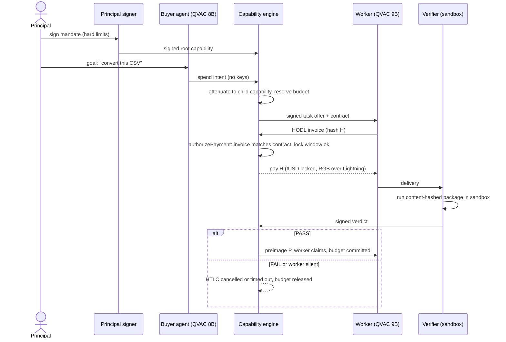

# Verdict

> Give agents permissions, not wallets. Pay workers for outcomes, not attempts.

Built for the RGB "Agentic Dollars" hackathon (Torino, 17–18 Oct 2026), tracks 04 and 01.

## Idea

- A person signs a **bounded mandate** (total budget, per-task limit, duration, who may be paid). The buyer agent never holds a key.
- The buyer agent (a local model, QVAC) asks the **capability engine** for permission to pay. The engine checks every request against the mandate and either signs it or refuses with a plain-language reason.
- Payment is an **RGB tUSD HODL invoice over Lightning**: funds stay locked until a deterministic **verifier** runs a fixed test package on the worker's delivery and signs a verdict.
- PASS releases the secret and the worker is paid. FAIL, or a worker that disappears, returns the funds and the budget.
- Everything runs on real regtest RGB-Lightning, and local models do the planning and the work.

## Architecture

Actors and components:

- **Principal**: the human who defines and signs the mandate.
- **Principal signer**: holds the principal's key and issues the signed root capability.
- **Buyer agent** (local QVAC model): turns a goal into spend intents. It has no keys.
- **Capability engine**: the policy and payment authority. It attenuates the root capability into child capabilities, reserves budget, signs task offers and contracts, checks that incoming invoices match the contract, and pays or cancels.
- **Worker** (local QVAC model): accepts a task offer, produces the delivery, and issues a HODL invoice.
- **Verifier** (sandbox): runs a content-hashed test package against the delivery and signs a verdict.
- **Payment rail**: RGB tUSD over Lightning with HODL invoices, so the payment is conditional on the preimage.

### Flow



### Key properties

- **Authority, not custody**: agents act through signed, attenuated capabilities; only the engine can authorize payment, and only within the mandate.
- **Outcome-based payment**: the HODL invoice locks funds until a verdict exists, so the worker is paid for a passing result, never for an attempt.
- **Deterministic judgment**: the verifier runs a fixed, content-hashed package in a sandbox, so the same delivery always yields the same signed verdict.
- **Safe failure**: on FAIL or silence the HTLC is cancelled or times out, and the reserved budget is released back to the mandate.
- **Real money rail**: the demo path never simulates a payment. Fakes exist only in tests and are rejected in demo mode.

## RGB and the UTEXO fork

Escrow needs HODL invoices, and only the UTEXO fork of `rgb-lightning-node` provides them. It sits on the same RGB v0.11.1 protocol line as RGB-Tools. The organizers approved this fork on 2026-10-09. Wallet and RGB Lightning go through Tether WDK, while mandate and contract signatures are Ed25519 (outside WDK). Everything else RGB comes from RGB-Tools / rgb-protocol v0.11.1.

## Deployment topologies

- **Single machine (default)**: wallet daemons, engine, signer, buyer, worker, verifier and UI all run locally.
- **Two machines (fallback)**: the verifier runs on a separate machine with no wallet and no model, connected over a direct link rather than venue Wi-Fi.

## Team

**Team Knots**

| Name | GitHub |
|---|---|
| Silvio Meneguzzo | [@smeneguz](https://github.com/smeneguz) |
| Stefano Leto | [@ThirdChildren](https://github.com/ThirdChildren) |

## Stack

| Layer | Choice |
|---|---|
| Runtime | Node.js 24, TypeScript strict, pnpm 12 workspaces |
| Backend | Fastify 5, Zod 4, pino, better-sqlite3, libsodium (Ed25519, sealed box) |
| Local AI | `@qvac/sdk` 0.21 (llama.cpp on an RTX 3080): buyer Qwen3 8B, worker Qwen3.5 9B |
| Wallet and RGB | `@tetherto/wdk` + `@utexo/wdk-rgb-lightning` + `@utexo/rgb-lightning-node-nodejs` (UTEXO fork, RGB v0.11.1 line, approved by the organizers on 2026-10-09) |
| Network | Bitcoin regtest in containers (bitcoind, electrs, RGB proxy) |
| Frontend | Vite, React 19, Tailwind v4, shadcn/ui |
| Tests | Vitest, fast-check, Biome, Playwright screenshots |

Installed and working before the event on the Legion (Fedora, RTX 3080): the full stack above, the regtest environment, both QVAC models, the Rust build of the RGB Lightning binding. On the Mac: nothing yet (the verifier kit is prepared but was never run on a Mac; that is one of the first things we do today).

## Prior work (declared)

Everything below existed before 09:30 on 17 October. It was built by the two of us in the week of 9–16 October, with Claude Code as implementation accelerator, in the preparation repository **`verdict-prep`** (https://github.com/ThirdChildren/verdict-prep, 171 commits with real dates). If it is still private when you read this, ask us at the desk and we will show it.

What exists in `verdict-prep`:

- About 26 600 lines of TypeScript across 14 workspace packages: protocol (schemas, canonical JSON, signing, amounts, state machine), wallet adapter and wallet daemon, capability engine, principal signer, buyer agent, worker, verifier, verifier test package `csv2json-v1`, demo UI, regtest scripts, e2e harness.
- About 450 unit and integration tests; e2e scenarios on real regtest with the real models: PASS (26 s), FAIL with refund (9 s), worker disappears with HTLC expiry (about 70 s).
- Two read-only security reviews of the funds path and sandbox, with fixes.
- Docs: architecture spec, 29 ADRs, SDK notes, demo script, known limits, and a step-by-step build playbook.

During the event we **rebuild this repository from that playbook in reviewable chunks** (one commit per layer, each passing its checks), then build the new work listed in "Built during the hackathon". The commit history shows which is which.

## How to run

Full steps land with `docs/SETUP.md`. The short version, on a Linux machine with Node 24, pnpm 12, a container runtime and a 16 GB NVIDIA GPU:

```bash
pnpm install --frozen-lockfile
pnpm keys:init && pnpm regtest:up && pnpm regtest:setup
pnpm demo:reset            # wallet daemons + RGB channel (about 60 s)
pnpm dev:verifier          # terminal 2
pnpm dev:stack --wallet    # terminal 1: engine, signer, buyer, worker, UI
```

Checks: `pnpm typecheck && pnpm lint && pnpm test`. Real regtest end to end: `pnpm test:e2e`.

## Built during the hackathon

One line per commit that is not a rebuild chunk.

- (none yet)

## What is mocked, simulated or hard-coded

- Nothing in the demo path: every payment is a real RGB tUSD HODL invoice over Lightning on local regtest. `FakeWallet` and `FakeLlm` exist for unit tests only and throw under `VERDICT_MODE=demo`.
- Hard-coded by design for the MVP: one task type (CSV to JSON) with one verifier package written by us; one preconfigured worker; one trusted verifier named in the signed contract; regtest only, test dollars with no value.
- The UI has a `?mock=1` storyboard mode for development only, with a visible "MOCK DATA" banner.

## RGB, QVAC and WDK usage

- **RGB:** tUSD issued as an RGB asset on regtest; RGB channel open between buyer and worker nodes; HODL invoice create, pay, claim with preimage, cancel, and expiry refund, all carrying tUSD.
- **QVAC:** buyer agent (Qwen3 8B, structured JSON output validated with Zod) turns the goal into a mandate proposal and spend intents; worker agent (Qwen3.5 9B) writes the delivered program and self-checks it; both on-device, streamed live to the UI.
- **WDK:** wallets for buyer and worker, RGB Lightning invoices, payments, HODL claim and cancel go through WDK and `@utexo/wdk-rgb-lightning`. Mandate, capability and contract signatures are Ed25519 via libsodium, not WDK.

## Honesty and safety

No secrets in this repository: seeds and keys live in `~/.verdict-data`, ignored by git. Known limits will be stated in `docs/LIMITS.md`. If something on stage is a recording, we say so.
