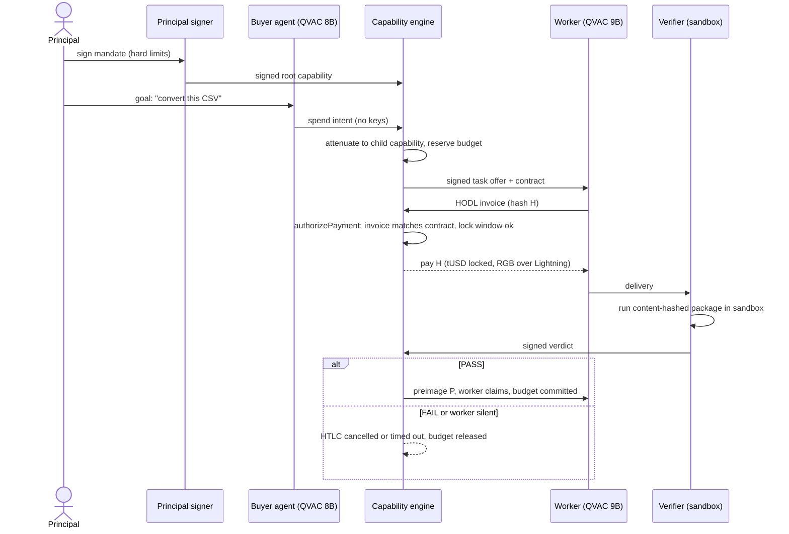

# Verdict

> Give agents permissions, not wallets. Pay workers for outcomes, not attempts.

Built for the RGB "Agentic Dollars" hackathon (Torino, 17–18 Oct 2026), tracks 04 and 01.

## Idea

- A person signs a **bounded mandate** (total budget, per-task limit, duration, who may be paid). The buyer agent never holds a key.
- The buyer agent (a local model, QVAC) asks the **capability engine** for permission to pay. The engine checks every request against the mandate and either signs it or refuses with a plain-language reason.
- Payment is an **RGB tUSD HODL invoice over Lightning**: funds stay locked until a deterministic **verifier** runs a fixed test package on the worker's delivery and signs a verdict.
- PASS releases the secret and the worker is paid. FAIL, or a worker that disappears, returns the funds and the budget.
- Everything runs on real regtest RGB-Lightning, and local models do the planning and the work.

## Architecture

Actors and components:

- **Principal**: the human who defines and signs the mandate.
- **Principal signer**: holds the principal's key and issues the signed root capability.
- **Buyer agent** (local QVAC model): turns a goal into spend intents. It has no keys.
- **Capability engine**: the policy and payment authority. It attenuates the root capability into child capabilities, reserves budget, signs task offers and contracts, checks that incoming invoices match the contract, and pays or cancels.
- **Worker** (local QVAC model): accepts a task offer, produces the delivery, and issues a HODL invoice.
- **Verifier** (sandbox): runs a content-hashed test package against the delivery and signs a verdict.
- **Payment rail**: RGB tUSD over Lightning with HODL invoices, so the payment is conditional on the preimage.

### Flow

### Key properties

- **Authority, not custody**: agents act through signed, attenuated capabilities; only the engine can authorize payment, and only within the mandate.
- **Outcome-based payment**: the HODL invoice locks funds until a verdict exists, so the worker is paid for a passing result, never for an attempt.
- **Deterministic judgment**: the verifier runs a fixed, content-hashed package in a sandbox, so the same delivery always yields the same signed verdict.
- **Safe failure**: on FAIL or silence the HTLC is cancelled or times out, and the reserved budget is released back to the mandate.
- **Real money rail**: the demo path never simulates a payment. Fakes exist only in tests and are rejected in demo mode.

## RGB and the UTEXO fork

Escrow needs HODL invoices, and only the UTEXO fork of `rgb-lightning-node` provides them. It sits on the same RGB v0.11.1 protocol line as RGB-Tools. The organizers approved this fork on 2026-10-09. Wallet and RGB Lightning go through Tether WDK, while mandate and contract signatures are Ed25519 (outside WDK). Everything else RGB comes from RGB-Tools / rgb-protocol v0.11.1.

## Deployment topologies

- **Single machine (default)**: wallet daemons, engine, signer, buyer, worker, verifier and UI all run locally.
- **Two machines (fallback)**: the verifier runs on a separate machine with no wallet and no model, connected over a direct link rather than venue Wi-Fi.

## Team

**Team Knots**

- Silvio Meneguzzo
- Stefano Leto
