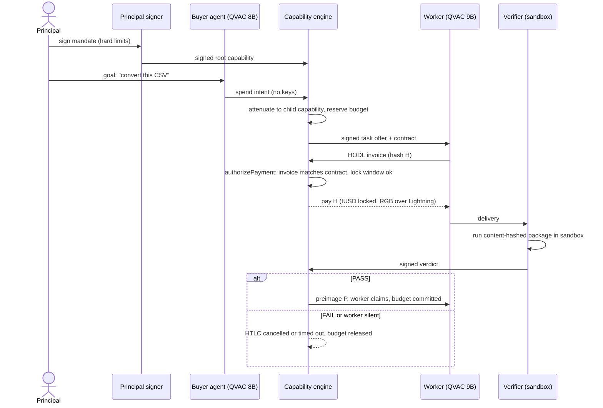

# Verdict

> Give agents permissions, not wallets. Pay workers for outcomes, not attempts.

Built for the RGB "Agentic Dollars" hackathon (Torino, 17–18 Oct 2026), tracks 04 and 01.

## Idea

- A person signs a **bounded mandate** (total budget, per-task limit, duration, who may be paid). The buyer agent never holds a key.
- The buyer agent (a local model, QVAC) asks the **capability engine** for permission to pay. The engine checks every request against the mandate and either signs it or refuses with a plain-language reason.
- Payment is an **RGB tUSD HODL invoice over Lightning**: funds stay locked until a deterministic **verifier** runs a fixed test package on the worker's delivery and signs a verdict.
- PASS releases the secret and the worker is paid. FAIL, or a worker that disappears, returns the funds and the budget.
- Everything runs on real regtest RGB-Lightning, and local models do the planning and the work.

## Architecture

Actors and components:

- **Principal**: the human who defines and signs the mandate.
- **Principal signer**: holds the principal's key and issues the signed root capability.
- **Buyer agent** (local QVAC model): turns a goal into spend intents. It has no keys.
- **Capability engine**: the policy and payment authority. It attenuates the root capability into child capabilities, reserves budget, signs task offers and contracts, checks that incoming invoices match the contract, and pays or cancels.
- **Worker** (local QVAC model): accepts a task offer, produces the delivery, and issues a HODL invoice.
- **Verifier** (sandbox): runs a content-hashed test package against the delivery and signs a verdict.
- **Payment rail**: RGB tUSD over Lightning with HODL invoices, so the payment is conditional on the preimage.

### Flow



### Key properties

- **Authority, not custody**: agents act through signed, attenuated capabilities; only the engine can authorize payment, and only within the mandate.
- **Outcome-based payment**: the HODL invoice locks funds until a verdict exists, so the worker is paid for a passing result, never for an attempt.
- **Deterministic judgment**: the verifier runs a fixed, content-hashed package in a sandbox, so the same delivery always yields the same signed verdict.
- **Safe failure**: on FAIL or silence the HTLC is cancelled or times out, and the reserved budget is released back to the mandate.
- **Real money rail**: the demo path never simulates a payment. Fakes exist only in tests and are rejected in demo mode.

## RGB and the UTEXO fork

Escrow needs HODL invoices, and only the UTEXO fork of `rgb-lightning-node` provides them. It sits on the same RGB v0.11.1 protocol line as RGB-Tools. The organizers approved this fork on 2026-10-09. Wallet and RGB Lightning go through Tether WDK, while mandate and contract signatures are Ed25519 (outside WDK). Everything else RGB comes from RGB-Tools / rgb-protocol v0.11.1.

## Deployment topologies

- **Single machine (default)**: wallet daemons, engine, signer, buyer, worker, verifier and UI all run locally.
- **Two machines (fallback)**: the verifier runs on a separate machine with no wallet and no model, connected over a direct link rather than venue Wi-Fi.

## Team

**Team Knots**

| Name | GitHub |
|---|---|
| Silvio Meneguzzo | [@smeneguz](https://github.com/smeneguz) |
| Stefano Leto | [@ThirdChildren](https://github.com/ThirdChildren) |

## Stack

| Layer | Choice |
|---|---|
| Runtime | Node.js 24, TypeScript strict, pnpm 12 workspaces |
| Backend | Fastify 5, Zod 4, pino, better-sqlite3, libsodium (Ed25519, sealed box) |
| Local AI | `@qvac/sdk` 0.21 (llama.cpp on an RTX 3080): buyer Qwen3 8B, worker Qwen3.5 9B |
| Wallet and RGB | `@tetherto/wdk` + `@utexo/wdk-rgb-lightning` + `@utexo/rgb-lightning-node-nodejs` (UTEXO fork, RGB v0.11.1 line, approved by the organizers on 2026-10-09) |
| Network | Bitcoin regtest in containers (bitcoind, electrs, RGB proxy) |
| Frontend | Vite, React 19, Tailwind v4, shadcn/ui |
| Tests | Vitest, fast-check, Biome, Playwright screenshots |

Installed and working before the event on the Legion (Fedora, RTX 3080): the full stack above, the regtest environment, both QVAC models, the Rust build of the RGB Lightning binding. On the Mac (macOS 26, Node 24): the verifier only, with `pnpm verifier:selftest` passing 9 of 10 sandbox fixtures (1 skipped by design) on 17 October.

## How to run

Full steps: `docs/SETUP.md`. The short version, on a Linux machine with a container runtime and a 16 GB NVIDIA GPU:

```bash
nvm use            # or fnm use: Node 24 from .nvmrc
corepack enable    # pnpm 12.10.1 from package.json; pnpm 9 silently ignores the supply-chain settings
pnpm install --frozen-lockfile   # always frozen: a bare install rewrites the lockfile
pnpm keys:init && pnpm regtest:up && pnpm regtest:setup
pnpm demo:reset            # wallet daemons + RGB channel (about 60 s)
pnpm dev:verifier          # terminal 2
pnpm dev:stack --wallet    # terminal 1: engine, signer, buyer, worker, UI
```

Checks: `pnpm typecheck && pnpm lint && pnpm test`. Real regtest end to end: `pnpm test:e2e`.

Verifier on a second machine (macOS or Linux, no wallet, no model): `docs/MAC_VERIFIER.md`. Nothing reads a `.env` file: export variables in the shell; `.env.example` lists them.

## Built during the hackathon

- `bf9b893` The verifier now runs on macOS: the Seatbelt sandbox profile grants Node the metadata it needs at startup (run dir, output dir) while keeping the expected answers unreadable, emits resolved paths (`/var` is a symlink), and the selftest hides the package exactly like the runner. 40/40 verifier tests and the selftest pass on a Mac.
- `050860f` `.env.example` now lists the variables the services really read, with the real ports (signer 7403, worker 7405) and the LAN, demo and model switches; vitest ignores stale `dist/` output.
- `4de913e` `fcf89fc` Demo UI redesigned to an industrial, old-school layout: one ink, one paper, one accent; no rounded corners, pills, icons or tinted status cards; grotesk plus monospace with tabular numerals; fonts no longer fetched from the network (the venue has none); header as a one-line budget ledger; the five escrow steps as ledger rows; refusals and outcomes as plain ruled blocks. Behaviour, shortcuts and copy unchanged.
- `9f8facb` 54 protocol negative-vector tests: envelope mutation never verifies, signature encoding and malleability, dirhash edge cases, payee attenuation, amount rejection.
- `abbfd82` README run steps with the real prerequisites (Node 24, corepack, frozen install) and the second-machine verifier.
- `498c42c` `eb6db0a` Replace the mandate while one is active: a new root retires the previous one and its unused permissions in one ledger transaction, returns the unused budget, lets a task in flight finish under its own permission and refuses new spend requests under the retired one; security-reviewed (one high finding fixed before merge). The wizard explains what replacing means and the ledger switches to the new ceiling.
- `f3e81c0` The worker's generation loop honours the contract deadline: attempts stop at deadline minus verification time, the best attempt so far is delivered or the task fails fast; a missing sandbox counts as a failed attempt.
- `b36b491` Model calls have timeouts and can be aborted (a stuck model becomes a plain 504, never a hung request); the buyer agent reports its goal, reasoning and intent hash for the Agents panel; the evidence route returns the accepted intent, never the secret.
- `9c83177` UX pass as a three-minute judge over 52 scene, viewport and theme combinations: 18 findings fixed (dead end after signing in mock mode, stale shortcut opening a dialog, English task text, banner above dialogs, Esc everywhere, readable task rows, presenter size fit at 1280x640).
- `0f903da` AGENTS panel (shortcut `a`): for the selected request, what the buyer decided (goal, mandate, spend intent, the engine's answer), what the worker did (attempts with self-check and tok/s, the full delivered file with copy and download), what the verifier found (checks, exit code, signed verdict), and a chronological work log in plain words. Fields the services do not report yet say so instead of being invented.
- `c761954` `scripts/doctor.sh` with roles: the verifier role checks only what a second machine needs and passes on macOS; the legion role adds the model cache, the Node 22 issuer and portable port and GPU checks.
- `66b5607` macOS deliveries can no longer read the repository checkout; the macOS sandbox limits are documented.
- `a6425ab` Repo-wide data-dir inventory test tolerates missing workspace folders during the layered build.

## What is mocked, simulated or hard-coded

- Nothing in the demo path: every payment is a real RGB tUSD HODL invoice over Lightning on local regtest. `FakeWallet` and `FakeLlm` exist for unit tests only and throw under `VERDICT_MODE=demo`.
- Hard-coded by design for the MVP: one task type (CSV to JSON) with one verifier package written by us; one preconfigured worker; one trusted verifier named in the signed contract; regtest only, test dollars with no value.
- The UI has a `?mock=1` storyboard mode for development only, with a visible "MOCK DATA" banner.

## RGB, QVAC and WDK usage

- **RGB:** tUSD issued as an RGB asset on regtest; RGB channel open between buyer and worker nodes; HODL invoice create, pay, claim with preimage, cancel, and expiry refund, all carrying tUSD.
- **QVAC:** buyer agent (Qwen3 8B, structured JSON output validated with Zod) turns the goal into a mandate proposal and spend intents; worker agent (Qwen3.5 9B) writes the delivered program and self-checks it; both on-device, streamed live to the UI.
- **WDK:** wallets for buyer and worker, RGB Lightning invoices, payments, HODL claim and cancel go through WDK and `@utexo/wdk-rgb-lightning`. Mandate, capability and contract signatures are Ed25519 via libsodium, not WDK.

## Honesty and safety

No secrets in this repository: seeds and keys live in `~/.verdict-data`, ignored by git. Known limits are stated in `docs/LIMITS.md`; questions a reviewer may ask, with evidence, in `docs/FAQ.md`. If something on stage is a recording, we say so.
